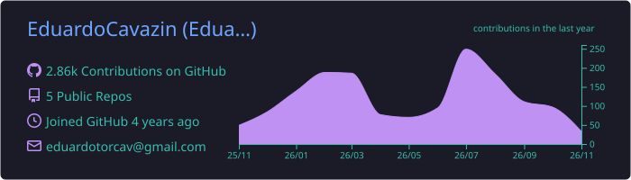
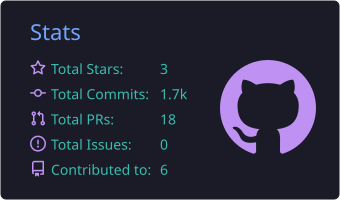
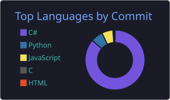

<h1 align="center">Hi, I'm Eduardo 👋</h1>
<h3 align="center">Software Developer · C#/.NET · Python/FastAPI · Flutter</h3>

  
  

---

### 🧑‍💻 About me

- 🧾 Software Developer at **Unimake Software**, working on **UniNFe**, an open-source C#/.NET solution for Brazilian electronic fiscal documents (NF-e, NFC-e, CT-e) integrated with SEFAZ
- 🚀 Building my own products: REST APIs with **FastAPI** and mobile apps with **Flutter**
- 🎓 B.Sc. in Software Engineering (IFPR), with an exchange semester at the Polytechnic Institute of Bragança, Portugal
- 🧱 Into Clean Architecture, TDD and well-structured code
- 📍 Paranavaí, PR - Brazil

---

### 🛠️ Tech stack

**Backend**

**Mobile**

**Database & tools**

---

### 📌 Featured projects

| Project | Description | Stack |
| --- | --- | --- |
| **FinApp** | Personal finance app: credit card invoices, installments, recurring subscriptions with push reminders | FastAPI · Flutter · Firebase |
| **FleetTrack** | Multi-tenant SaaS for small-business fleets, with real-time updates and role-based access | FastAPI · Flutter · WebSockets |
| **AviaryPro** | RESTful API for managing rural properties, aviaries and flocks (final thesis), built with TDD | Clean Architecture · TDD |
| **HASS** | Educational CPU simulator (single-cycle and pipeline) with an ncurses interface | C |

<!-- Troque os nomes por links quando os repositórios forem públicos, ex.: [**AviaryPro**](https://github.com/EduardoCavazin/nome-do-repo) -->

---

### 📊 GitHub stats

  

  
  

